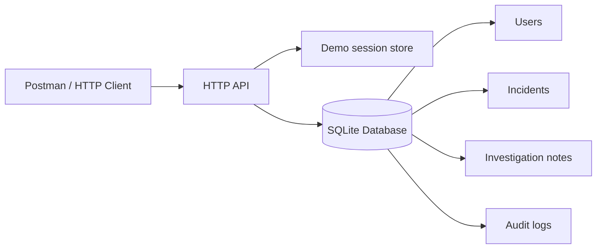

# Architecture and data model

The Python HTTP handler translates JSON input into incident operations. `security.py` verifies salted password hashes and supplies short-lived in-memory bearer tokens; role checks occur at every protected route. `storage.py` owns schema setup and parameterized SQLite operations. Denied access attempts are stored in `audit_logs`, and incidents reference their reporter and optionally an assigned analyst using foreign keys.

**Deliberate boundary:** The assignment requires nine independent services communicating via APIs. Here, the audit table and login are teaching stubs located alongside one incident-service example. They are not a claim of a complete service-oriented architecture.
